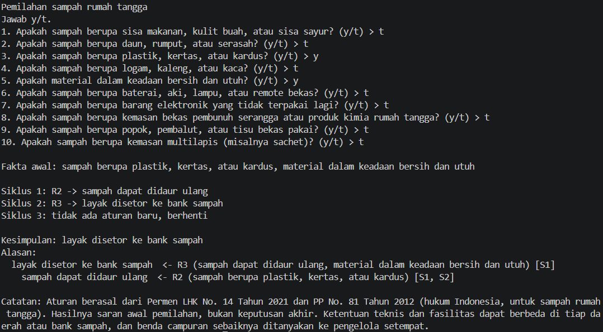
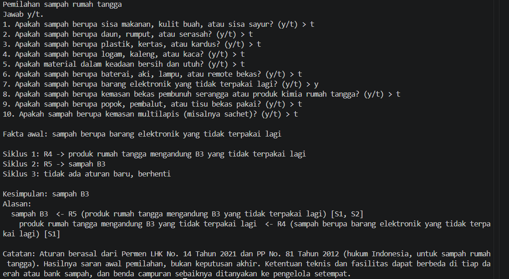
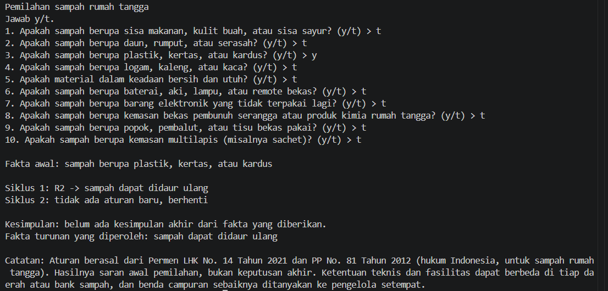

# Smart Waste – Sistem Pakar Pemilahan Sampah Rumah Tangga

Tugas Materi 5, Kecerdasan Buatan (MKL1303131), Teknik Informatika UNRAM
- **Nama:** Rila Yayu Wahyuningsih
- **NIM:** F1D02510024

## 1. Topik dan cara menjalankan

Topik: menentukan ke mana sebuah sampah rumah tangga harus dipilah (kompos, bank sampah, B3, atau sampah lainnya/residu), berdasarkan peraturan pemerintah Indonesia.
- Bahasa: Python 3.14 (tanpa library tambahan)
- Berkas: `smart_waste.py` (mesin inferensi) dan `kb_sampah.json` (aturan dan sumber)
- Perintah (jalankan di folder yang sama dengan kedua berkas):
```
python smart_waste.py
```
Jawab pertanyaan dengan `y` (ya) atau `t` (tidak).

## 2. Sumber
| Kode | Sumber |
|------|--------|
| S1 | Peraturan Menteri Lingkungan Hidup dan Kehutanan Nomor 14 Tahun 2021 tentang Pengelolaan Sampah pada Bank Sampah. Kementerian LHK RI. https://jdih.kemenkoinfra.go.id/cfind/source/files/permen-lhk/2021pmlhk014.pdf. Diakses 12 Nov 2026. |
| S2 | Peraturan Pemerintah Nomor 81 Tahun 2012 tentang Pengelolaan Sampah Rumah Tangga dan Sampah Sejenis Sampah Rumah Tangga. Pemerintah RI. https://peraturan.go.id/files/pp81-2012bt.pdf. Diakses 12 Nov 2026. |

## 3. Tabel aturan

Aturan ditulis dalam `kb_sampah.json`. Mode `atau` berarti salah satu syarat cukup, mode `dan` berarti semua syarat harus ada. Setiap aturan menunjuk sumbernya.
| Aturan | IF | THEN | Sumber |
|--------|----|------|--------|
| R1 | sisa makanan/kulit buah/sisa sayur **OR** daun/rumput/serasah | sampah mudah terurai | S1 Pasal 6 ayat (3); S2 Pasal 17 ayat (2) huruf b |
| R2 | plastik/kertas/kardus **OR** logam/kaleng/kaca | sampah dapat didaur ulang | S1 Pasal 6 ayat (5); S2 Pasal 17 ayat (2) huruf d |
| R3 | sampah dapat didaur ulang **AND** material bersih dan utuh | layak disetor ke bank sampah | S1 Lampiran III huruf g |
| R4 | baterai/aki/lampu/remote bekas **OR** barang elektronik tidak terpakai | produk rumah tangga mengandung B3 yang tidak terpakai lagi | S1 Pasal 6 ayat (2) huruf a dan c; Lampiran I |
| R5 | produk rumah tangga mengandung B3 yang tidak terpakai lagi **OR** kemasan bekas pembunuh serangga/produk kimia rumah tangga | sampah B3 | S1 Pasal 6 ayat (2); S2 Pasal 17 ayat (2) huruf a |
| R6 | popok/pembalut/tisu bekas pakai **OR** kemasan multilapis | sampah lainnya (residu) | S1 Pasal 6 ayat (6); S2 Pasal 17 ayat (2) huruf e |
| R7 | sampah mudah terurai | layak dikomposkan | S1 Pasal 9 ayat (1)-(2); Lampiran I huruf c.1 |

**Kesimpulan akhir (4):** layak dikomposkan, layak disetor ke bank sampah, sampah B3, sampah lainnya (residu).
**Rantai aturan** (hasil satu aturan dipakai aturan lain): R1 → R7, R2 → R3, dan R4 → R5.
Catatan kejujuran sumber:
- R3: sumber hanya *menganjurkan* sampah bersih dan utuh (nilai ekonomi lebih tinggi). Saya menjadikannya syarat "layak disetor".
- R6: sumber hanya mendefinisikan "sampah lainnya" sebagai sampah yang tidak masuk jenis lain. Contoh bendanya (popok, tisu, kemasan multilapis) adalah penerapan saya.

## 4. Metode: Forward Chaining
Alasan memilih FC: pengguna biasanya sudah tahu ciri sampahnya (bahan, kondisi), sehingga alurnya natural dari fakta ke kesimpulan. Aturan juga berantai (misalnya R2 → R3), dan FC menampilkan rantai itu dengan jelas.
Langkah:

```
memori <- fakta yang dijawab "ya" oleh pengguna
ULANGI:
    cocok <- aturan yang syaratnya terpenuhi oleh memori DAN hasilnya belum ada di memori
    JIKA cocok kosong: BERHENTI
    r <- cocok[0]
    tambahkan r.maka ke memori
    catat bahwa r.maka berasal dari r      # bahan "alasan"
```

Cara kerja forward chaining di program saya:
1. Jawaban "ya" dari pengguna dimasukkan ke memori.
2. Program mencari aturan yang syaratnya sudah ada di memori. Kalau modenya `dan`, semua syarat harus ada. Kalau `atau`, satu syarat saja sudah cukup. Aturan yang hasilnya sudah ada di memori dilewati.
3. Kalau tidak ada aturan yang cocok, program berhenti.
4. Kalau ada, aturan pertama yang cocok dijalankan: hasilnya ditambahkan ke memori dan aturannya dicatat untuk bagian alasan.
5. Lalu program kembali ke langkah 2, karena hasil yang baru bisa membuat aturan lain terpenuhi.
Aturan yang hasilnya sudah ada dilewati supaya program tidak berputar terus.
Contoh pada kasus uji 1 (jawaban "ya": plastik/kertas/kardus dan bersih dan utuh):
Fakta yang tidak pernah menjadi hasil aturan (misalnya "sampah berupa plastik") ditanyakan ke pengguna. Kesimpulan akhir adalah hasil aturan yang tidak dipakai sebagai syarat aturan lain. Alasan dicetak dengan menelusuri balik aturan yang menghasilkan kesimpulan.

## 5. Kasus uji

| No | Jawaban "ya" | Kesimpulan yang diharapkan | Hasil program |
|---|--------------|----------------------------|---------------|
| 1 | plastik/kertas/kardus; bersih dan utuh | layak disetor ke bank sampah | sesuai |
| 2 | barang elektronik tidak terpakai | sampah B3 | sesuai |
| 3 | plastik/kertas/kardus saja (tidak bersih) | tidak ada kesimpulan akhir (kasus negatif) | sesuai: hanya fakta turunan "sampah dapat didaur ulang" |

hasil program:

**Kasus 1: plastik bersih dan utuh (menghasilkan kesimpulan)**



**Kasus 2: barang elektronik tidak terpakai (menghasilkan kesimpulan)**



**Kasus 3: plastik/kertas/kardus tidak bersih (tidak menghasilkan kesimpulan akhir)**



## 6. Batas keberlakuan
Pengetahuan dalam program ini berasal dari Permen LHK No. 14 Tahun 2021 dan PP No. 81 Tahun 2012, yaitu aturan pemerintah Indonesia untuk pemilahan sampah rumah tangga. Program hanya mencakup tujuh aturan dan jenis sampah yang umum di rumah tangga (10 pertanyaan), tidak mencakup sampah medis, industri, atau konstruksi. Ketentuan teknis dan fasilitas dapat berbeda di tiap daerah atau bank sampah, dan benda campuran sebaiknya ditanyakan ke pengelola setempat. Hasilnya adalah saran awal pemilahan, bukan keputusan akhir. Batas ini juga ditampilkan di akhir keluaran program.

## 7. Penggunaan Alat Bantu AI
Dalam pengerjaan proyek Smart Waste ini, saya menggunakan Claude (Anthropic) sebagai alat bantu untuk membuat file basis pengetahuan dalam format JSON (kb_sampah.json) yang berisi aturan-aturan pemilahan sampah beserta sumber referensinya.
Sementara itu, proses pengerjaan lainnya saya lakukan secara mandiri, mulai dari mencari dan mempelajari sumber peraturan pemerintah, dimana ini saya searching melalui google, saya belajar untuk memahami konsep sistem pakar dan metode Forward Chaining karna ini yang menurut saya sejalan dengan yang saya mau, menyusun alur program dengan adanya pertanyaan-pertanyaan yang pastinya untuk memberikan kesimpulan akhir , menulis kode Python (smart_waste.py) ada juga bebebrapa bagian kode yang saya tanyakan ke ai karna saya belum sepenuhnya paham dengan bahasa pemrograman python ini , saya mengambil python karna dia mudah dan kode yang kita pakai itu seperti bahasa manusia tidak terlalu kompleks, saya melakukan pengujian dengan beberapa kasus, disini saya ambil 3 kasus saja lalu saya mengambil screenshot hasil program yaitu outputan dari apa yang kita pilih gitu.
